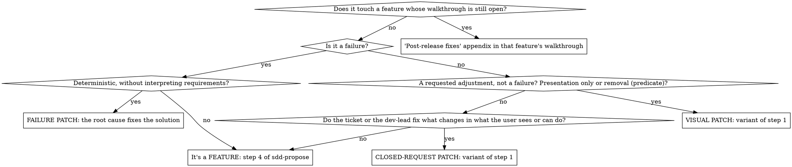

## Is it really a patch?

**Fixed solution**: the request says what changes in what the user sees or can do, and you're left only with what isn't seen. Choosing between proposals already written (in the ticket or in the row) with closed questions to the dev-lead is still a patch; proposing an option nobody wrote is not, even if you let them choose: writing the options yourself is designing the solution. «Avisa cuando el total pase de 1.000 €» leaves the text, the place and the threshold unfixed: it's a feature, even if small and even if they ask for a patch. «Un comando `facturas <cliente>` con su formato; sin facturas, `sin facturas <cliente>`; y `exportar` sin mes, `indica un mes`» fixes every literal and still isn't a patch: three new behaviors, three tests; lite if its predicate holds. A closed request that changes one thing —a text, a destination— is one test: still a patch. «It's layout with design judgment» doesn't make it a feature (`tests/visual-patch-red.md`, v2), nor «add an event» with the solution in the ticket (`tests/patch-lane-red.md`, p1 and p2). A proposed solution for a failure doesn't turn it into a closed request: it's still a failure, and the root cause confirms the proposal fixes it.

**Presentation-only adjustment predicate**, one of two cases. **Moving**: the change touches templates or styles only (`.html`, `.component.html`, `.razor`, `.cshtml`…; CSS, SCSS, LESS); in the templates it only moves, wraps or changes the class of elements, without adding, removing or changing bindings, control directives (`@if`, `*ngIf`, `v-if`, `@for`), event handlers, visible text or i18n keys; and it doesn't touch TypeScript or other code, API, data or capabilities. **Removal**: it removes visible elements and what becomes dead by removing them —their handlers, their state, their texts and i18n keys, and the data-only migration that retires them—, removes only what nobody else uses, and adds nothing: «Quita Borrar y añade Archivar en su sitio» is a feature. If what's removed was something the user could do, `patch.md` says so in one line and carries the capability delta. If a condition fails, it isn't a visual adjustment: follow the tree. A failure fixed only in CSS (an unreadable text, a covered modal) isn't an adjustment: it's a bug, with `sdd-debugging`, root cause and `Fixed`, even if its verification carries a screenshot. «I only touch the template» doesn't make it a visual adjustment if the template gains an `@if` or a text: it's a closed request if the ticket or the dev-lead fix the condition or the literal text, and a feature if not. Nor is it a direct edit (`tests/visual-patch-red.md`, v1 and c2).

That the reporter "believes they know the cause" does NOT make the bug deterministic: your investigation determines the cause, not the report.

## The patch's estimate

If `.docs/sdd/steering/estimation.md` exists, estimate the patch in hours when you open it, plus the closing gate's duration, named: the last one measured in the project —search the newest `patch.md` and walkthroughs of `changes/` or `specs/` for it; what you time in this patch doesn't count—, or what its «Gate de cierre» says: «0,5 h + 0,55 h del gate de cierre (33 min, patch 0212)». The lane question carries the estimate, and without a question (a lane the request brings, `unattended`) you still hand it over; `sdd-implement` writes it in `patch.md` before the fix.

## Red flags — STOP

- You're about to open as a patch a request that doesn't fix the solution because «it's small» or because they asked for a patch.

| Rationalization | Reality |
| --- | --- |
| "It's simple / the client expects it today" | What's really small has its lanes: patch or config. |
| "Operations already knows the cause" | The report describes the symptom. Your investigation determines the cause with evidence in the code. |
| "I've been asked for a patch and it's small" | Size and the word don't fix the solution. If you decide the text, the place or the rule, it's a feature. |
| "The ticket proposes the fix: it's a closed request, I skip the root cause" | A failure is still a failure: the root cause confirms the proposal fixes it. |
