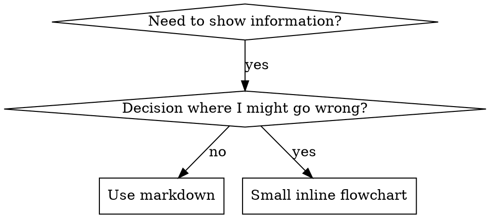

# Flowcharts in Skills

<!-- kit: 0312 · sustituye: «superpowers:writing-skills.» -->
Part of sdd-agent-writing.

## Flowchart Usage



**Use flowcharts ONLY for:**
- Non-obvious decision points
- Process loops where you might stop too early
- "When to use A vs B" decisions

**Never use flowcharts for:**
- Reference material → Tables, lists
- Code examples → Markdown blocks
- Linear instructions → Numbered lists
- Labels without semantic meaning (step1, helper2)
<!-- kit: 0312 · quita: «See `graphviz-conventions.dot` in…one SVG ```» -->
