# Executing Plans

Execute the plan yourself, task by task, in this session: no implementer
subagent per task, no reviewer per task. One fresh-context review of the
whole branch at the end.

**Why inline:** Subagent-driven development pays for a fresh implementer
and a fresh reviewer on every task, each re-reading the codebase from zero.
Inline execution pays for one context (yours) plus one reviewer at the end.
What it gives up is a fresh context per task and a second pair of eyes per
task. This skill keeps what those two things bought, by other means: the
brief is the spec, the ledger is your memory, TDD is the per-task gate, and
the final reviewer is the second pair of eyes.

**Core principle:** The plan already did the thinking. Execute it exactly,
prove each step with a test you watched fail and then pass, and leave a
record that survives your own forgetting.

**Narration:** between tool calls, narrate at most one short line — the
ledger and the tool results carry the record.

**Continuous execution:** Do not pause to check in with your human partner
between tasks. They chose inline execution to spend less, not to answer
"should I continue?" after every task. Execute all tasks from the plan
without stopping.

**Rulings, not stalls.** Conflicts, ambiguities, plan defects — decide them.
The spec is the binding authority, the plan is its argument, and your
judgment settles what neither answers. Record every decision in the ledger
as `Ruling: <what you decided> — <why> — <what it costs if wrong>`, and keep
going. Deviating from the plan without a ledgered ruling is a decision made
in secret.

<!-- kit: 0296 · sustituye: «Four things stop you, and only these…and a plan so broken that every path forward is a guess.» -->
These stop you, and nothing else: an irreversible or destructive operation; a security-sensitive action; a side effect outside this worktree that norms say you ask about first (a merge, a push to a shared branch, a publish); a plan so broken that every path forward is a guess; a deviation from the approved spec or a scope brake (`sdd-implement`, «Deviations and rulings»); and, in `pair`, the stop after each task (`sdd-implement`, «After each task»). For those, stop and ask.

## When to Use

<!-- kit: 4597d47e · sustituye: «You have a plan from superpowers:writing-plans and your human partner chose inline execution at the handoff.» -->
- `sdd-implement` chose Native for this plan.
<!-- kit: 4597d47e · sustituye: «tool (see the per-platform references in `../using-superpowers/references/`).» -->
- Your harness has no subagent tool. Never fabricate a dispatch; run
<!-- kit: fin -->
  the plan here.
- Tasks are mostly independent — the same precondition as
<!-- kit: 4597d47e · sustituye: «superpowers:subagent-driven-development.» -->
  `sdd-implement-subagent`.
<!-- kit: fin -->

A fully specified plan makes inline execution transcription plus testing:
it runs well on a mid-tier session model, and the one place the most
<!-- kit: 4597d47e · sustituye: «which this skill» -->
capable model earns its cost is the final review, whose axes `sdd-verify` dispatches separately. Tell your human partner so when they choose inline.

<!-- kit: 4597d47e · sustituye: «superpowers:subagent-driven-development» -->
Prefer `sdd-implement-subagent` when your human partner
<!-- kit: fin -->
wants a review gate on every task, or when the plan is long enough that
its later tasks would run on a compacted context. Inline execution over a
long plan still works — the ledger is what makes it recoverable — but the
last tasks get the least of you.

## The Process

```dot
digraph process {
    rankdir=TB;

    subgraph cluster_per_task {
        label="Per Task";
<!-- kit: 649f1a99 · sustituye: «task-start:» -->
        "sdd task start: brief + BASE; read the brief" [shape=box];
        "Base check; write the RED tests, keep a copy" [shape=box];
<!-- kit: fin -->
        "Work the steps in order: TDD, run every verification, read every output" [shape=box];
        "Step output matches plan's Expected?" [shape=diamond];
<!-- kit: 649f1a99 · sustituye: «systematic-debugging» -->
        "Plan wrong? Rule and ledger. Code wrong? sdd-debugging" [shape=box];
<!-- kit: fin -->
        "Commit as the plan's commit steps say" [shape=box];
        "Completion contract met?" [shape=diamond];
<!-- kit: 649f1a99 · sustituye: «task-done: run tests,» -->
        "sdd task done: run the Verificación, ledger the result; mark todo complete" [shape=box];
<!-- kit: fin -->
    }

    "Setup: worktree, workspace + ledger, read plan + spec, pre-flight scan" [shape=box];
    "More tasks remain?" [shape=diamond];
<!-- kit: 649f1a99 · sustituye: «"Final whole-branch review (fresh reviewer if you have one)"…"Use superpowers:finishing-a-development-branch"» -->
    "sdd-verify: final review in axes (fresh reviewers, in the background)" [shape=box];
    "sdd-verify: closing of the review" [shape=box];
    "Closing done: rulings to tasks.md, delete this plan's workspace" [shape=box];
    "sdd-archive (validation)" [shape=box style=filled fillcolor=lightgreen];
<!-- kit: fin -->

<!-- kit: 649f1a99 · sustituye: «task-start:» -->
    "Setup: worktree, workspace + ledger, read plan + spec, pre-flight scan" -> "sdd task start: brief + BASE; read the brief";
<!-- kit: 649f1a99 · sustituye: «task-start:» -->
    "sdd task start: brief + BASE; read the brief" -> "Base check; write the RED tests, keep a copy";
    "Base check; write the RED tests, keep a copy" -> "Work the steps in order: TDD, run every verification, read every output";
<!-- kit: fin -->
    "Work the steps in order: TDD, run every verification, read every output" -> "Step output matches plan's Expected?";
<!-- kit: 649f1a99 · sustituye: «systematic-debugging» -->
    "Step output matches plan's Expected?" -> "Plan wrong? Rule and ledger. Code wrong? sdd-debugging" [label="no"];
<!-- kit: 649f1a99 · sustituye: «systematic-debugging» -->
    "Plan wrong? Rule and ledger. Code wrong? sdd-debugging" -> "Work the steps in order: TDD, run every verification, read every output";
<!-- kit: fin -->
    "Step output matches plan's Expected?" -> "Commit as the plan's commit steps say" [label="yes, last step"];
    "Commit as the plan's commit steps say" -> "Completion contract met?";
    "Completion contract met?" -> "Work the steps in order: TDD, run every verification, read every output" [label="no - finish the task"];
<!-- kit: 649f1a99 · sustituye: «task-done: run tests,…"Use superpowers:finishing-a-development-branch";» -->
    "Completion contract met?" -> "sdd task done: run the Verificación, ledger the result; mark todo complete" [label="yes"];
    "sdd task done: run the Verificación, ledger the result; mark todo complete" -> "More tasks remain?";
    "More tasks remain?" -> "sdd task start: brief + BASE; read the brief" [label="yes"];
    "More tasks remain?" -> "sdd-verify: final review in axes (fresh reviewers, in the background)" [label="no"];
    "sdd-verify: final review in axes (fresh reviewers, in the background)" -> "sdd-verify: closing of the review";
    "sdd-verify: closing of the review" -> "Closing done: rulings to tasks.md, delete this plan's workspace";
    "Closing done: rulings to tasks.md, delete this plan's workspace" -> "sdd-archive (validation)";
<!-- kit: fin -->
}
```

## Setup

Ensure the work happens in an isolated workspace: use
<!-- kit: d59bf7b5 · sustituye: «superpowers:using-git-worktrees» -->
`sdd-worktrees` with `Skill` to create one or verify the existing one.
<!-- kit: fin -->
Never start implementation on a main/master branch without your human
partner's explicit consent.

Conversation memory does not survive compaction. An inline executor that
loses its place re-implements tasks whose commits already exist — the same
failure as a controller re-dispatching them, paid for in your own context.
Track progress in a ledger file, not only in todos. Harness todos are a
live view; the ledger is the record.

<!-- kit: 4597d47e · sustituye: «superpowers:subagent-driven-development» -->
The workspace and ledger are shared with `sdd-implement-subagent`
<!-- kit: fin -->
— same directory, same format — so a plan can change executors mid-flight
and the new one resumes from the same ledger.

<!-- kit: 31783aa5 · sustituye: «at skill start, run `../subagent-driven-development/scripts/sdd-workspace PLAN_FILE` by its absolute path, from the working tree you're executing in — it prints the plan's git-ignored directory (`<repo-root>/.superpowers/sdd/<plan-basename>/`),» -->
- Each plan owns a workspace: run `node "${CLAUDE_PLUGIN_ROOT}/cli/bin/sdd.js" workspace <plan>`; it prints the plan's git-ignored directory, home to every artifact for THIS plan: ledger, briefs, reports, review packages. Another plan's directory is never yours to read or write. **Your next message to the user**, right under its phase notice, carries this line, also when you resume: `Workspace del plan: <ruta> — ledger, briefs, informes y paquetes de revisión; no se versiona y se borra cuando la revisión final queda limpia` (resuming, add `· retomo en la Task <N>`). «Preparo el workspace» isn't it (`tests/sdd-implement-red.md`, `tests/sdd-implement-green.md`). The `sdd <verb>` of this skill (`workspace`, `task start|done|brief`, `review package`, `ledger rulings`) runs the same way, from any shell.
<!-- kit: fin -->
- Check for this plan's ledger at `<workspace>/progress.md`. If its first
  line names your plan file, tasks with a `Task <N>: complete` line are
  DONE — do not redo them; resume at the first task without one. Their
  commits exist in git even when your context no longer remembers making
  them: after compaction, trust the ledger and `git log` over your own
  recollection. A ledger whose first line names a different plan file is
  another plan's progress: leave it and start your own, fresh.
- Create the ledger with its identity as the first line:
  `# SDD ledger — plan: <plan file path>`.
- `git clean -fdx` will destroy the workspace (it's git-ignored scratch);
  if that happens, recover from `git log`.

<!-- kit: 4597d47e -->
`tasks.md` doesn't replace the ledger: after a compaction it's the ledger that says what's done (`tests/native-adapt-red.md`).

Read the plan once, note its context and Global Constraints, and create a
todo per task. If the plan names a Spec, read that too: the spec is the
authority the plan argues from, and conflicts inside the plan resolve
against it. A plan with no reachable spec gets a ledger note saying so —
rulings made without one are provisional.

<!-- kit: 31783aa5 · sustituye: «superpowers:test-driven-development» -->
**REQUIRED SUB-SKILL:** load `sdd-tdd` with `Skill` now,
<!-- kit: fin -->
before Task 1. It governs every step of every task below; a plan whose
steps already say "write the failing test first" does not exempt you
from reading it.

<!-- kit: 31783aa5 -->
Read once the `## Quality decalogue` of [implementer-prompt.md](../sdd-implement-subagent/implementer-prompt.md#quality-decalogue): it governs the code you write, under the project's quality article.

<!-- kit: e7ddf254 · sustituye: «Before Task 1, scan the plan for conflicts between tasks…its brief, not here.» -->
**Pre-flight scan**: before Task 1, scan the plan once for conflicts, writing down what you checked as you check it: tasks that contradict each other or the plan's Global Constraints, and anything the plan explicitly mandates that the review rubric treats as a defect (a test that asserts nothing, verbatim duplication of a logic block). The scan's output is a table in the ledger, not a verdict. One row for every pair of tasks that share a file or an interface: the two tasks, what one produces against what the other consumes, and what you found. One row for every task: whether its own text agrees with itself — the tests it specifies against the code it specifies, the files it creates against the files it later touches. «The scan is clean» without those rows is not a scan you ran. Rule on everything you find before execution begins — each finding against the plan text that mandates it, with the spec as the binding authority — and record each ruling beside its row. If the scan is clean, proceed without comment. The final review remains the net for conflicts that only emerge from implementation.

## The Task Loop

Everything you print, and every tool result, stays resident in your
context for the rest of the session. Redirect long test output to a file
in the workspace and read its tail; read a brief, not the whole plan.

### 1. Take the task

<!-- kit: 4dcb5598 · sustituye: «Run this skill's `scripts/task-start PLAN_FILE N` by its absolute path, from the working tree you're executing in.» -->
- Run `node "${CLAUDE_PLUGIN_ROOT}/cli/bin/sdd.js" task start <plan> <n>`. It prints the brief
<!-- kit: fin -->
  path and BASE (the commit the task's range is cut from) in one call.
  Read the brief for every task, including ones you remember from setup:
  what you remember is a summary, the brief has the exact values,
  signatures, and test cases.
- Mark the task's todo in_progress.

<!-- kit: 4597d47e -->
Before the first `task start`, `tasks.md`; before the first step, the base check and the RED tests: `sdd-implement`, «Before each task».

Every tool call is a turn that re-reads your whole context. Bookkeeping
rides along with work — a ledger append in the same call as the commit,
<!-- kit: 4dcb5598 · sustituye: «never in a call of its own.» -->
with one exception: the completion line is `sdd task done`'s, in its own call after the commit you checked (step 4).

### 2. Work the steps

The plan's steps are already in RED-GREEN order; follow them in that
<!-- kit: 31783aa5 · sustituye: «superpowers:test-driven-development» -->
order under `sdd-tdd`, loaded at setup. A test
<!-- kit: fin -->
step's code is written first and run first. Watching it fail is a step,
not a formality — a test that passes before the implementation exists is
a finding about the test.

Every step that runs a command has an `Expected:` line. Run the command,
read its output, and compare. Three outcomes:

- **Matches.** Next step.
<!-- kit: ae7cad00 · sustituye: «superpowers:systematic-debugging.» -->
- **The code is wrong.** Use `sdd-debugging`. Find the cause; never patch the symptom to make the step's output match. A failing smoke of text an agent follows (a skill, a prompt): if the constitution has a rule on the form of guidance, read it before the round, name the failure's class by it and write the round in that form; rewording or adding emphasis is the same form.
<!-- kit: fin -->
- **The plan is wrong** — a step contradicts the spec, an interface from an
  earlier task doesn't match what this task consumes, a command that
  cannot work. Rule on the smallest change that satisfies the spec, ledger
  it as `Task <N>: Ruling: <finding> — <what you decided and why>`, and
  continue. The ruling is carried, not remembered: later tasks that touch
  the same interface read it from the ledger.

Commit as the plan's commit steps say. A task that spans several commits
is fine; BASE is what the review range is cut from, never `HEAD~1`.

### 3. The completion contract

Before a task's ledger line, all of the following are true, with evidence
in this session — not inferred from the diff looking right:

- Every test the brief names exists and ran in this task, and you read
  the output.
<!-- kit: e7ddf254 · sustituye: «`task-done`» -->
- The final test run for the task passed — `sdd task done` is that run, and
<!-- kit: fin -->
  it writes the command and result into the ledger line.
- Every `Expected:` line in the brief was compared against real output.
- Every deviation from the brief has a `Ruling:` line in the ledger.

<!-- kit: 02afa007 · sustituye: «superpowers:verification-before-completion» -->
**REQUIRED SUB-SKILL:** `sdd-verify` governs
<!-- kit: fin -->
the claim. If any item is missing, the task is not complete: finish it.

### 4. Complete the task

<!-- kit: 4597d47e -->
Close, in this order: compare the RED copy with the committed test, as `sdd-implement`, «Before each task», says; commit the task; check the commit exists — if `HEAD` is still at the task's base, the pre-commit rejected it: read its message and fix the cause before committing again, because the task's «Verificación» is narrower than the hook and `sdd task done` would pass anyway (`tests/closing-verification-red.md`).

<!-- kit: e7ddf254 · sustituye: «Run this skill's `scripts/task-done PLAN_FILE N BASE -- <test command>` by its absolute path, from the working tree you're executing in, with the test command the brief names for the whole task.» -->
Then, in its own call, run `node "${CLAUDE_PLUGIN_ROOT}/cli/bin/sdd.js" task done <plan> <n> <base> -- <command…>` with the command of the task's «Verificación». It runs the
<!-- kit: fin -->
tests, keeps the full output in the workspace, prints the tail, and — only
if they pass — appends the completion line to the ledger:

`Task <N>: complete (commits <base7>..<head7>, tests: <command> → <result>)`

A failing run records nothing; the task is not complete. When it records,
mark the todo complete and take the next task.

<!-- kit: 4597d47e -->
The line's range ends at `HEAD`, and it records the task even if the command prints nothing. The command must exit non-zero on failure: with Pester, `-CI`, or `Invoke-Pester` exits 0 with a red test (`tests/task-done-exit-code-red.md`).

<!-- kit: 4597d47e -->
Before taking the next task, do what `sdd-implement`, «After each task», asks of this one.

## Final Review

<!-- kit: 649f1a99 · sustituye: «Run `../subagent-driven-development/scripts/review-package PLAN_FILE MERGE_BASE HEAD`…There is no second fix pass.» -->
**REQUIRED SUB-SKILL:** `sdd-verify` runs the final whole-branch review and its single closing: its axes go out in the background as soon as the last task's commit exists, and you come back here, to [Finish](#finish), when its closing is done.

The silence watch of each dispatch and the closing drafts are `sdd-implement`'s, «After the last task».
<!-- kit: fin -->

## Finish

<!-- kit: e7ddf254 -->
Run `node "${CLAUDE_PLUGIN_ROOT}/cli/bin/sdd.js" ledger rulings <plan>` and paste its lines into `tasks.md` under `## Rulings` (without `tasks.md`, in the validation's presentation).

Before you delete anything, collect every ledger line containing
`Ruling:` into your final message under "Rulings I made", in the order you
made them, each with what it costs if wrong, and every `minor (deferred)`
<!-- kit: e7ddf254 · sustituye: «exhaustive. Your final…reach them.» -->
line under "Deferred minors". Both lists are exhaustive: if the ledger holds a ruling, the list holds it. Your final message is the only place the decisions you took on the user's behalf — and the findings you chose not to act on — reach them: they read it and rework whatever you got wrong. The lists feed «Decisiones tomadas sin el dev-lead» of the walkthrough. A ruling that dies with the workspace was a decision made in secret.

When the final review is clean and its fixes are committed, delete this
plan's workspace directory — the git history is the record now. Sibling
directories belong to other plans; leave them alone.

<!-- kit: 64a86577 · sustituye: «Use superpowers:finishing-a-development-branch.» -->
Then invoke `sdd-archive` with `Skill`: its first step is the validation.

## Common Rationalizations

| Excuse | Reality |
|--------|---------|
| "I remember what Task N says" | You remember a summary. The brief has the exact values. Read it. |
| "The plan's code is right, skip watching the test fail" | A test you never saw fail proves nothing. It is one step. Run it. |
| "I'll run the full suite at the end instead of per step" | Per-step runs are how you learn which step broke it. The end-of-task run is the contract, not a substitute. |
| "The plan is wrong here, I'll just do the right thing" | Do the right thing and ledger the ruling. Unledgered deviation is a decision made in secret. |
<!-- kit: d08b7a59 · sustituye: «task, in the same message as the commit.» -->
| "I'll write the ledger lines after a few tasks" | Compaction does not wait for a convenient moment. One line per task: `sdd task done` writes it right after the commit you checked. |
<!-- kit: fin -->
<!-- kit: e7ddf254 · sustituye: «four» -->
| "Let me check in before the next task" | They chose inline to spend less. Progress prompts spend their time instead. Only the stops listed above stop you. |
<!-- kit: fin -->
| "I read my own diff carefully; the final reviewer is redundant" | Same author, same blind spots. The reviewer is the only fresh context this run buys. |
| "Tests should pass, the change was trivial" | "Should" is not evidence. The contract requires the command and its output. |
| "Subagents are slow and expensive, I'll skip the final review too" | Inline already removed the per-task reviewers. One review of the whole branch is the floor, not the ceiling. |
| "The reviewer said Minor, so it's Minor" | The label graded the spec's silence. Grade what the person gets. Re-grade, then gate. |
| "The fix is obvious, no need for a failing test first" | The failing test is the only proof the finding was real and is now gone. Without it you have a diff and a hope. |
<!-- kit: 97ec9c02 · sustituye: «your partner did not ask for. Ledger them; your partner decides.» -->
| "I'll fix the minors too while I'm in there" | Every minor you fix is a test, a fix, and a suite run that only the final review's `review.minors: fix` asks for; otherwise, ledger them. |
<!-- kit: fin -->
