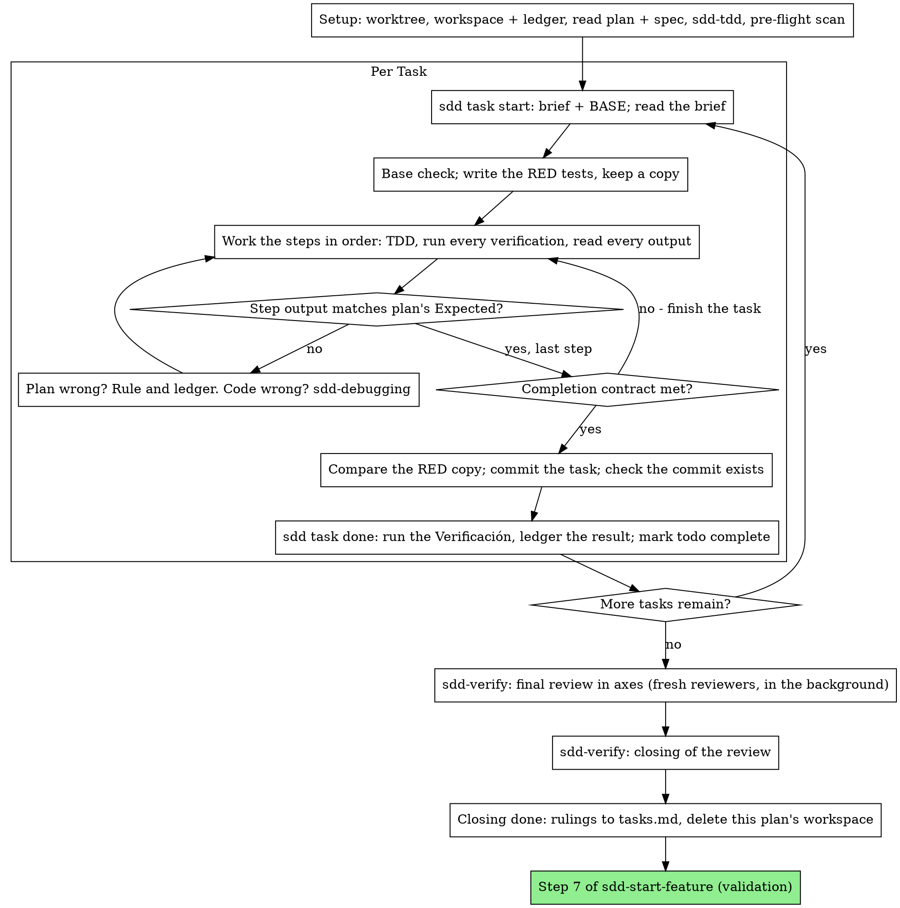
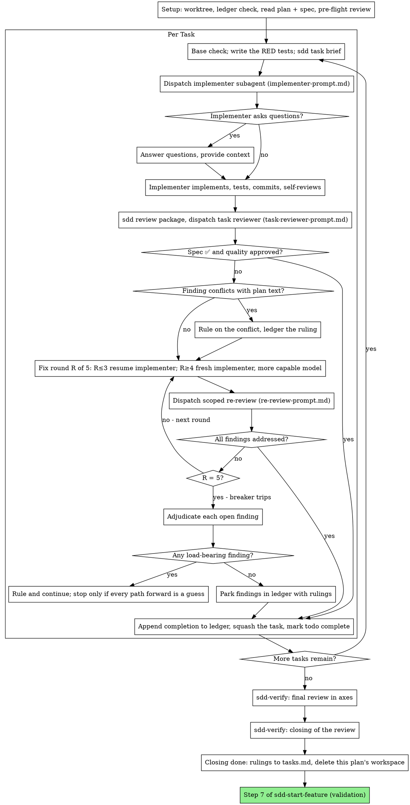

# sdd-implement

## Overview

Execute the approved plan, task by task, and leave a record that survives your own forgetting. Write everything the user reads in the language of their message. Forked from `executing-plans` and `subagent-driven-development` of superpowers 7.0.0 (MIT, see `NOTICE`); the text is the source's, changed only where the kit works differently.

**Core principle:** the plan already did the thinking. Execute it exactly, prove each step with a test you watched fail and then pass, and leave a record that survives your own forgetting.

**Your first message after loading this skill**, new run or resumed, carries under its phase notice the line `Workspace del plan: <ruta> — …` of [Setup](#setup), step 2. Saying «preparo el workspace» or «leo el ledger» isn't it.

**Narration:** between tool calls, narrate at most one short line — the ledger and the tool results carry the record. The phase notice of `sdd-start-feature` still opens each change of step.

**Continuous execution:** do not pause to check in with the user between tasks. Execute all tasks from the plan without stopping: in Native, the plan's `Ejecución` line chose it to spend less, not to answer «should I continue?» after every task. «Should I continue?» prompts and progress summaries waste their time — they asked you to execute the plan, so execute it. Four things stop you, and only these: an irreversible or destructive operation; a security-sensitive action; a side effect outside this worktree that norms say you ask about first (a merge, a push to a shared branch, a publish); and a plan so broken that every path forward is a guess. For those, stop and ask. The kit's own stops are a fifth class, not an exception to the four: a **deviation** from the approved spec, a **scope brake** and, in `pair`, the stop after each task ([Deviations and rulings](#deviations-and-rulings)).

## Method

The plan's `Ejecución` line decides, for the whole plan. With `execution: auto` its reason weighs four factors by name, with no numeric threshold: how much the tasks depend on each other's interfaces, how many there are, what an error reaching the branch costs, and whether the plan fits one context. In lite mode, without a plan, `spec.md` is the plan: the method is `execution` if `sdd-kit.json` fixes it, and Native with `auto`. If your harness has no subagent tool, the plan runs here, in Native: never fabricate a dispatch.

- **Native**: you implement every task in this session, with the ledger: no implementer subagent per task, no reviewer per task, and one fresh-context review of the whole branch at the end. SDD pays for a fresh implementer and a fresh reviewer on every task, each re-reading the codebase from zero; Native pays for one context (yours) plus one reviewer at the end. What it gives up is a fresh context per task and a second pair of eyes per task. This skill keeps what those two things bought, by other means: the brief is the spec, the ledger is your memory, TDD is the per-task gate, and the final reviewer is the second pair of eyes. The cheapest: a fully specified plan makes it transcription plus testing, it runs well on a mid-tier session (Sonnet, effort medium), and the one place the most capable model earns its cost is the final review, whose axes `sdd-verify` dispatches separately.
- **SDD** (`Ejecución: subagent`): a fresh implementer subagent per task, a task review (spec compliance + code quality) after each, and a broad whole-branch review at the end. You delegate tasks to specialized agents with isolated context. By precisely crafting their instructions and context, you ensure they stay focused and succeed at their task. They should never inherit your session's context or history — you construct exactly what they need. This also preserves your own context for coordination work. Fresh subagent per task + task review (spec + quality) + broad final review = high quality, fast iteration.

**SDD against Native:** a fresh subagent per task (no context pollution) instead of one context doing every task; a review after each task (spec compliance + code quality) instead of only at the end; it costs a fresh context per task and per review, where Native costs one context plus one final reviewer. Use it when a review gate per task is wanted, or when the plan is long enough that its later tasks would run on a compacted context. Native over a long plan still works — the ledger is what makes it recoverable — but the last tasks get the least of you.

Both run in this session, share the workspace, the ledger and its format, and never pause between tasks: a plan can change method mid-flight and the new one resumes from the same ledger. After a compaction in Native with two or more tasks without their `complete` line, the rest goes on with SDD over the same ledger, without stopping in `delegate` or `unattended`; with one task left, Native goes on. Ledger it every time, with either outcome: `Task <N>: Ruling: compactación — sigo con <Native | SDD> — quedan <k> tasks` (with one, `queda 1 task`; the task you were on counts); the walkthrough's `Compactación:` line comes from it. After compaction you reread the plan and the ledger, not this skill.

## Setup

1. **Worktree**: invoke `sdd-worktrees` with `Skill`; it detects or creates the isolated workspace, runs `env:setup` if `.docs/sdd/environments.md` exists and the baseline with the project's closing gate.
2. **Workspace**: each plan owns one. Run `node "${CLAUDE_PLUGIN_ROOT}/cli/bin/sdd.js" workspace <plan>`; it prints the plan's git-ignored directory, home to every artifact of THIS plan: ledger, briefs, reports, review packages. Another plan's directory is never yours to read or write. **Your next message to the user**, right under its phase notice, carries this line, also when you resume: `Workspace del plan: <ruta> — ledger, briefs, informes y paquetes de revisión; no se versiona y se borra cuando la revisión final queda limpia` (resuming, add `· retomo en la Task <N>`). «Preparo el workspace» isn't it (`tests/sdd-implement-red.md`, `tests/sdd-implement-green.md`). The `sdd <verb>` of this skill (`workspace`, `task start|done|brief`, `review package`, `ledger rulings`) runs the same way, from any shell.
3. **Ledger**: conversation memory does not survive compaction. An executor that loses its place re-implements tasks whose commits already exist — the same failure as a controller re-dispatching them, paid for in your own context; in real sessions, controllers that lost their place have re-dispatched entire completed task sequences — the single most expensive failure observed. Track progress in a ledger file, not only in todos: harness todos are a live view; the ledger is the record. It lives at `<workspace>/progress.md`, and it is your recovery map. If its first line names your plan, tasks with a `Task <N>: complete` line are DONE — don't redo or re-dispatch them; resume at the first task without one. Their commits exist in git even when your context no longer remembers making them: after compaction, trust the ledger and `git log` over your own recollection. A task whose last line is a fix round is mid-loop: resume the loop at the next round. A ledger whose first line names another plan is another plan's progress: leave it in place and start your own, fresh, with the identity line `# SDD ledger — plan: <plan path>`. `git clean -fdx` will destroy the workspace (it's git-ignored scratch); if that happens, recover from `git log`. `tasks.md` doesn't replace the ledger: after a compaction it's the ledger that says what's done (`tests/native-adapt-red.md`).
4. **Read** the plan once, note its context and Global Constraints, and create a todo per task. Read its spec too: the spec is the authority the plan argues from, and conflicts inside the plan resolve against it. A plan with no reachable spec gets a ledger note saying so — rulings made without one are provisional. With more than one task, `tasks.md` is the **living record** (status and commit hash per task); the harness todo list is ephemeral.
5. **TDD**: load `sdd-tdd` with `Skill` now, before Task 1 — a **REQUIRED SUB-SKILL**. It governs every step of every task you implement; a plan whose steps already say «write the failing test first» does not exempt you from reading it. In Native, read once the `## Quality decalogue` of [implementer-prompt.md](references/implementer-prompt.md): it governs the code you write, under the project's quality article.
6. **Pre-flight scan**: before Task 1, scan the plan once for conflicts, writing down what you checked as you check it: tasks that contradict each other or the plan's Global Constraints, and anything the plan explicitly mandates that the review rubric treats as a defect (a test that asserts nothing, verbatim duplication of a logic block). The scan's output is a table in the ledger, not a verdict. One row for every pair of tasks that share a file or an interface: the two tasks, what one produces against what the other consumes, and what you found. One row for every task: whether its own text agrees with itself — the tests it specifies against the code it specifies, the files it creates against the files it later touches. «The scan is clean» without those rows is not a scan you ran. Rule on everything you find before execution begins — each finding against the plan text that mandates it, with the spec as the binding authority — and record each ruling beside its row. If the scan is clean, proceed without comment. The task review (in Native, the final review) remains the net for conflicts that only emerge from implementation.
7. **Effort**: before the first dispatch of the feature —the implementer in SDD, the final review's axes in Native— check that the `sdd-kit:effort-<level>` type is among the session's agents. If not, say so before dispatching, dispatch with the `model` and the phrase «effort: no disponible en este harness, hereda el de la sesión», and record it as a ruling.

## Before each task

Every task, the second and later ones too, in both methods:

1. **Check the base first**, with or without a remote: `git diff $(git merge-base HEAD <integration>) <integration> -- .docs/sdd/roadmap.md`, with `<integration>` `develop` or the one the constitution fixes (with a remote, `git fetch` first and compare `origin/<integration>` too). Without a remote the base moves anyway: another worktree commits to the local branch. If the feature's row is in the diff, it's a scope brake: don't start or dispatch, and follow its row in the [gate table](../sdd-start-feature/references/control-profiles.md). Then cross `git diff --name-only $(git merge-base HEAD <integration>) <integration>` with the task's «Crear» and «Modificar» files: a match is the same brake, because another feature already changed what this one will touch.
2. **The RED tests are the thread's**: with the opening already in its commit, you write the tests that encode the task's scenarios —one per THEN and one per Review Focus line that names the task— in RED by compilation or by failure, without committing them: they go in the task's commit. Keep a copy outside the repo to compare later: it's the only proof the test wasn't fitted to the code (`tests/tests-red-hilo-red.md`).

## Native loop



Everything you print, and every tool result, stays resident in your context for the rest of the session. Redirect long test output to a file in the workspace and read its tail; read a brief, not the whole plan.

1. **Take the task**: `node "${CLAUDE_PLUGIN_ROOT}/cli/bin/sdd.js" task start <plan> <n>` prints the brief path and BASE, the commit the task's range is cut from, in one call. Read the brief for every task, including ones you remember from setup: what you remember is a summary, the brief has the exact values, signatures, and test cases. Mark the task's todo in_progress. Then the base check and the RED tests of [Before each task](#before-each-task). Every tool call is a turn that re-reads your whole context: bookkeeping rides along with work — a ledger append in the same call as the commit, never in a call of its own; the completion line is `sdd task done`'s, in its own call after the commit you checked (step 4).
2. **Work the steps**: the plan's steps are already in RED-GREEN order; follow them in that order under `sdd-tdd`, loaded at setup. A test step's code is written first and run first. Watching it fail is a step, not a formality — a test that passes before the implementation exists is a finding about the test. Every step that runs a command has an `Expected:` line. Run the command, read its output, and compare. Three outcomes:
   - **Matches.** Next step.
   - **The code is wrong.** Use `sdd-debugging`. Find the cause; never patch the symptom to make the step's output match. A failing smoke of text an agent follows (a skill, a prompt): if the constitution has a rule on the form of guidance, read it before the round, name the failure's class by it and write the round in that form; rewording or adding emphasis is the same form.
   - **The plan is wrong** — a step contradicts the spec, an interface from an earlier task doesn't match what this task consumes, a command that cannot work. Rule on the smallest change that satisfies the spec, ledger it as `Task <N>: Ruling: <finding> — <what you decided and why>`, and continue. The ruling is carried, not remembered: later tasks that touch the same interface read it from the ledger.
3. **Completion contract**: before a task's ledger line, all of the following are true, with evidence in this session — not inferred from the diff looking right:
   - Every test the brief names exists and ran in this task, and you read the output.
   - The final test run for the task passed — `sdd task done` is that run, and it writes the command and result into the ledger line.
   - Every `Expected:` line in the brief was compared against real output.
   - Every deviation from the brief has a `Ruling:` line in the ledger.

   **REQUIRED SUB-SKILL:** `sdd-verify` governs the claim. If any item is missing, the task is not complete: finish it.
4. **Close, in this order**: compare the RED copy with the committed test using `git diff --no-index` — a change that isn't formatting is a ruling in the ledger; commit the task; check the commit exists — if `HEAD` is still at the task's base, the pre-commit rejected it: read its message and fix the cause before committing again, because the task's «Verificación» is narrower than the hook and `sdd task done` would pass anyway (`tests/closing-verification-red.md`); then, in its own call, `node "${CLAUDE_PLUGIN_ROOT}/cli/bin/sdd.js" task done <plan> <n> <base> -- <command…>` with the command of the task's «Verificación». It runs the command, keeps the full output in the workspace, prints the tail and appends `Task <N>: complete (commits <base7>..<head7>, tests: <command> → <result>)` to the ledger, with `HEAD`; it records the task even if the command prints nothing. The command must exit non-zero on failure: with Pester, `-CI`, or `Invoke-Pester` exits 0 with a red test (`tests/task-done-exit-code-red.md`). A failing run records nothing; the task is not complete. When it records, mark the todo complete and take the next task. (`tests/native-adapt-red.md`)

| Excuse | Reality |
| --- | --- |
| "I remember what Task N says" | You remember a summary. The brief has the exact values. Read it. |
| "The plan's code is right, skip watching the test fail" | A test you never saw fail proves nothing. It is one step. Run it. |
| "I'll run the full suite at the end instead of per step" | Per-step runs are how you learn which step broke it. The end-of-task run is the contract, not a substitute. |
| "The plan is wrong here, I'll just do the right thing" | Do the right thing and ledger the ruling. Unledgered deviation is a decision made in secret. |
| "I'll write the ledger lines after a few tasks" | Compaction does not wait for a convenient moment. One line per task: `sdd task done` writes it right after the commit you checked. |
| "Let me check in before the next task" | Native was chosen to spend less. Progress prompts spend the user's time instead. Only the stops of the Overview stop you. |
| "I read my own diff carefully; the final reviewer is redundant" | Same author, same blind spots. The reviewer is the only fresh context this run buys. |
| "Tests should pass, the change was trivial" | «Should» is not evidence. The contract requires the command and its output. |
| "Subagents are slow and expensive, I'll skip the final review too" | Native already removed the per-task reviewers. One review of the whole branch is the floor, not the ceiling. |
| "The reviewer said Minor, so it's Minor" | The label graded the spec's silence. Grade what the person gets. Re-grade, then gate. |
| "The fix is obvious, no need for a failing test first" | The failing test is the only proof the finding was real and is now gone. Without it you have a diff and a hope. |
| "I'll fix the minors too while I'm in there" | Minor fixes cost a test, fix and suite run: only the final review's `review.minors: fix` asks them; else ledger them. |

## SDD loop



**Models**: use the least powerful model that can handle each role, to conserve cost and increase speed. Declare model and effort on every dispatch: an omitted model inherits your session's —often the most capable and most expensive—, which silently defeats this paragraph, and an omitted effort inherits the session's too. The effort travels in the agent type (`sdd-kit:effort-low`, `-medium`, `-high`) next to `model`.

- **Turn count beats token price.** Wall-clock and context cost scale with how many turns a subagent takes, and the cheapest models routinely take 2-3× the turns on multi-step work — costing more overall. Mid-tier is the floor for reviewers and for implementers working from prose descriptions. When the task's text already holds the complete code to write, the implementation is transcription plus testing: the cheapest tier for that implementer. Single-file mechanical fixes also take the cheapest tier.
- **Task complexity signals:** touches 1-2 files with the complete code in its text → the cheapest tier; touches multiple files with integration concerns (multi-file coordination, pattern matching, debugging) → mid-tier; requires design judgment or broad codebase understanding → the most capable available model, not the session default. The final review's axes take the models of `sdd-verify`.
- **Reviewers:** choose the model with the same judgment, scaled to the diff's size, complexity, and risk. A small mechanical diff does not need the most capable model; a subtle concurrency change does. Scoped re-reviews of small fix diffs take a cheap-to-mid tier —except the single re-review of the final review, which `sdd-verify` sends with `sdd-kit:effort-high` + `opus`.
- **Fix rounds 4-5:** a model at least one tier above the implementer that got stuck.
- `fable` and `opus xhigh` are forbidden by default, unless the task justifies it in writing.

**Batch small same-shape work.** When the plan lists several tasks that are each a small, independent edit of the same kind — the same one-line fix, constant change, or field addition repeated across files — do not dispatch one subagent per task. Compose ONE dispatch brief listing every file and its change, send the whole batch to a single subagent, and review its diff as one unit. Reserve one-dispatch-per-task for work that needs its own judgment, its own tests, or its own review surface.

**Hand artifacts over as files.** Everything you paste into a dispatch prompt — and everything a subagent prints back — stays resident in your context for the rest of the session and is re-read on every later turn.

**Waiting on dispatched subagents:** never poll a wait interface with short timeouts. While you have local work — ledger updates, packaging the next review, reading reports — keep working; child results arrive on their own. A stuck or lost child is noticed by its silence watch ([After the last task](#after-the-last-task)).

**Never dispatch multiple implementation subagents in parallel** (conflicts).

### 1. Dispatch the implementer

- Record BASE (`git rev-parse HEAD`) before dispatching — the review package and fix-round diffs need it.
- `node "${CLAUDE_PLUGIN_ROOT}/cli/bin/sdd.js" task brief <plan> <n>` extracts the task's full text to a uniquely named file and prints its path. Compose the dispatch so the brief stays the single source of requirements: its path goes in introduced as «read this first — it is your requirements, with the exact values to use verbatim», and exact values (numbers, magic strings, signatures, test cases) appear only in the brief. Never make a subagent read the whole plan.
- The dispatch is [implementer-prompt.md](references/implementer-prompt.md), filled, every section kept: the plan's «De código» block, literal, as first section (in lite mode, the constitution's code-quality article); the `## Quality decalogue`, as is; the RED tests' path as contract; the task's «Verificación» commands, not the full suite; one line on where the task fits; interfaces and decisions from earlier tasks the brief can't know; your resolution of any ambiguity you noticed in the brief; the report file (the brief's path with `-report.md`), where the implementer writes the full report, returning only status, commits, a one-line test summary, and concerns. (`tests/gates-reviews-red.md`, E3) The «De proceso» block (model policy, method) you apply: it doesn't travel.
- A dispatch describes one task, not the session's history. Do not paste accumulated prior-task summaries («state after Tasks 1-3») into later dispatches — a real session's dispatch hit 42k chars of which 99% was pasted history. A fresh subagent needs its task, the interfaces it touches, and the global constraints. Nothing else. If an earlier task parked a finding in the area this task touches, carry a pointer to that ledger entry.
- The dispatch carries the no-subagents contract (it is in the implementer template): the implementer never dispatches subagents — not helpers, and never a reviewer. Review arrives from you, after the report. In real sessions, every reviewer a worker spawned duplicated the task review the controller dispatched anyway — a full extra review seat per task.
- Record the implementer's agent identity from the dispatch result — fix rounds 1-3 resume this agent.
- **Slow verification**: if the task has «Verificación lenta», the implementer doesn't run it: you launch it in the background as soon as it reports, while the task review runs. Dispatch the next task meanwhile only if it shares no files with the running one and its brief forbids the commands that compete for the same binaries; if the slow verification fails, it opens the task's fix round.

### 2. Handle the report

Implementer subagents report one of four statuses. Handle each appropriately:

- **DONE**: build the review package and dispatch the task reviewer.
- **DONE_WITH_CONCERNS**: the implementer completed the work but flagged doubts. Read the concerns before proceeding. If the concerns are about correctness or scope, address them before review. If they're observations («this file is getting large»), note them and proceed to review.
- **NEEDS_CONTEXT**: the implementer needs information that wasn't provided. Provide the missing context and re-dispatch.
- **BLOCKED**: the implementer cannot complete the task. Assess the blocker: a context problem → more context, re-dispatch with the same model; the task requires more reasoning → re-dispatch with a more capable model; the task is too large → break it into smaller pieces; the plan itself is wrong → rule on the correction, ledger it, and re-dispatch with the ruling carried in the dispatch.

**Never** ignore an escalation or force the same model to retry without changes. If the implementer said it's stuck, something needs to change.

If the implementer asks questions — before starting or mid-task — answer clearly and completely, provide additional context if needed, and don't rush it into implementation.

When it returns, compare the RED copy with the committed test: a change that isn't formatting goes to the task reviewer.

### 3. Review the task

Per-task reviews are task-scoped gates. The broad review happens once, at the final whole-branch review. Never skip the task review, and never accept a report missing either verdict — spec compliance AND task quality are both required. Implementer self-review never replaces the task review; both are needed.

- Hand the reviewer its diff as a file: `node "${CLAUDE_PLUGIN_ROOT}/cli/bin/sdd.js" review package <plan> <BASE> HEAD` writes the commit list, stat and full diff with context to a file and prints its path. The output never enters your own context, and the reviewer sees all of it in one Read call. Use the BASE you recorded before dispatching the implementer — never `HEAD~1`, which silently drops all but the last commit of a multi-commit task. Never dispatch a task reviewer without a diff file.
- **Reviewer inputs:** dispatch [task-reviewer-prompt.md](references/task-reviewer-prompt.md), filled with the same brief, the report, the package and the plan's «De código» block, literal. That block is the reviewer's attention lens: what THIS project demands; the reviewer's template already carries the process rules (YAGNI, test hygiene, review method).
- Do not add open-ended directives like «check all uses» or «run race tests if useful» without a concrete, task-specific reason.
- Do not ask a reviewer to re-run tests the implementer already ran on the same code — the implementer's report carries the test evidence.
- Do not pre-judge findings for the reviewer — never instruct a reviewer to ignore or not flag a specific issue. If you believe a finding would be a false positive, let the reviewer raise it and adjudicate it in the review loop. If the prompt you are writing contains «do not flag», «don't treat X as a defect», «at most Minor» or «the plan chose» — stop: you are pre-judging, usually to spare yourself a review loop.

The task reviewer may report «⚠️ Cannot verify from diff» items — requirements that live in unchanged code or span tasks. These do not block the rest of the review, but you must resolve each one yourself before marking the task complete: you hold the plan and cross-task context the reviewer lacks. If you confirm an item is a real gap, treat it as a failed spec review — it enters the fix loop with the other findings.

### 4. The fix loop

The loop triggers when the review reports spec ❌, any Critical or Important finding, or a ⚠️ item you confirmed as a real gap. Before the loop starts, two routes leave it immediately:

- Record Minor findings in the ledger as you go (`Task <N>: minor (deferred): <one-liner>`), and point the final whole-branch review at that list so it can triage which must be fixed before merge. A roll-up nobody reads is a silent discard. Minor findings never enter the loop.
- A finding labeled plan-mandated — or any finding that conflicts with what the plan's text requires — is yours to rule on: weigh the finding against the plan text, decide with the spec as the binding authority, and ledger the ruling before you act on it. Do not dismiss the finding because the plan mandates it, and do not dispatch a fix that contradicts the plan without a recorded ruling.

Everything else enters the loop. A fix round is one fix dispatch plus one scoped re-review. Five rounds maximum per task:

- **Rounds 1-3 — resume the original implementer.** Send it the open findings verbatim. Its context is intact: it knows the task, the code, and its own choices. If your harness cannot send another message to a live subagent, dispatch a fresh implementer with [implementer-prompt.md](references/implementer-prompt.md) filled as in step 1, plus the report file and the findings — the report file is the persistent memory either way.
- **Rounds 4-5 — dispatch a fresh implementer on a more capable model** (per **Models**), with [implementer-prompt.md](references/implementer-prompt.md) filled as in step 1, plus the report file, the open findings, and this framing: «A prior implementer attempted this task [N] times; you own it now. Read the report file for what was tried.» A loop that survives three resumes usually means the implementer cannot see its own problem — fresh eyes and a capability bump in one move.
- **Every round, either way:** the implementer fixes, re-runs the tests covering the amended code, appends its fix report to the same report file, and returns the short contract. Before re-dispatching the reviewer, confirm the fix report contains the covering tests, the command run, and the output; dispatch the re-review once all three are present. Name the covering test files in the fix message — a one-line fix does not need the whole suite.
- **The re-review is scoped.** Run `sdd review package <plan> <FIX_BASE> HEAD`, where FIX_BASE is the head the previous review saw, and dispatch [re-review-prompt.md](references/re-review-prompt.md) with the findings list, the brief, the report file, and the printed diff path. The re-reviewer verdicts each finding ADDRESSED or NOT ADDRESSED and flags new breakage in the fix diff only. New Critical or Important breakage in the fix diff joins the open findings list. Out-of-scope observations go to the ledger as deferred minors — they never extend the loop.
- **After each round,** append to the ledger: `Task <N>: fix round <R>/5 (<X> addressed, <Y> open — <finding one-liners>; commits <a7>..<b7>)`.
- **Reproduce before fixing**: a Critical or Important finding that claims something about execution (an exception, an exit code, a value in a given environment or platform) is fixed by a test that reproduces it in RED first; the fix brief asks for it before the reviewer's proposed fix, and says that if the test isn't RED in one attempt, return `NEEDS_CONTEXT` with the test and its output, unfixed. Not reproducing it doesn't discard the finding: you fix without RED, reject or defer it, ledgered with the attempt's output. A finding you see reading the diff (a name, the structure, a duplication) skips this (`tests/post-final-review-red.md`, f1).

Never fix findings yourself in the controller session — your context stays clean for coordination, and controller fixes skip review.

**The breaker.** When round 5's re-review still leaves findings open, stop dispatching. Adjudicate each open finding yourself — you hold the plan and the cross-task context the reviewer lacks:

- **The reviewer is wrong, or the point is contestable:** park it — `Task <N>: parked — <finding> — Ruling: <why the code stands>`. The final review sees both sides.
- **Real, but nothing downstream builds on it:** park it the same way, with a ruling that says it's real and deferred.
- **Real and load-bearing** — a later task builds on it, or it reveals a plan defect: rule on the smallest change that unblocks the dependent work, ledger it as `Task <N>: Ruling: <finding> — <what you decided and why>`, and carry it into the next task's dispatch. Parking a structural failure silently lets every dependent task build on it. Stop only when the defect leaves every path forward a guess.

Adjudicate only at the cap. Adjudicating earlier to end a loop is pre-judging with a different name. Every adjudication is a ledger entry — a silent discard is forbidden.

### 5. Complete the task

When the review comes back clean — or every open finding is parked with a ruling at the cap — append the completion line to the ledger in the same message as your other bookkeeping: `Task <N>: complete (commits <base7>..<head7>, review clean)`, or `…, <K> parked)` after a tripped breaker. Squash the task's range into one commit with a message you write, even with a single commit, before dispatching the next task, unless a guard trips; its hash goes to `tasks.md` in the next milestone's commit ([commit-milestones.md](../sdd-start-feature/references/commit-milestones.md)). Then mark the todo complete and move on. Never move to the next task while the review has open Critical/Important issues that are neither fixed nor parked-with-ruling at the cap.

| Excuse | Reality |
| --- | --- |
| "Close enough on spec compliance" | Reviewer found spec gaps = not done. Fix or hit the cap and adjudicate — those are the only exits. |
| "I'll fix it myself, dispatching is overhead" | Controller fixes pollute your context and skip review. Resume the implementer. |
| "One more round will converge" | Past the cap, rounds don't converge — the failure is structural. Adjudicate and route. |
| "The reviewer will just find something new anyway" | Scoped re-reviews verify fixes; they cannot wander. New findings on untouched code go to the ledger, not the loop. |
| "This finding is obviously wrong, I'll drop it" | You adjudicate only at the cap, and every ruling is a ledger entry. Silent discards are forbidden. |
| "The fix was small, skip the re-review" | Unreviewed fixes are how regressions land. Every round ends with a scoped re-review. |
| "Reviews slow the loop down" | The loop without reviews is just unverified churn. Reviews are the loop's brakes and steering. |
| "Ledger bookkeeping is overhead" | The ledger is what survives compaction. Controllers without one have re-dispatched entire completed task sequences. |
| "The implementer spawned its own reviewer — free extra assurance" | It's a duplicate seat reviewing the same diff; the task review is the gate. A worker-spawned reviewer is a defect to flag, not rigor. |

## After each task

**Visual check**: if the task has «Verificación visual», after its review you look at it in a real browser before marking it done in `tasks.md`: with Playwright, the MCP if the session has it and otherwise a script with the `playwright` package, applying [frontend-verification.md](../sdd-start-feature/references/frontend-verification.md): the `§Frontend` detector of `tech-stack.md` in its two viewports, one screenshot per state and theme checked with the rubric against the reference screen, and computed-style measurements only if the criterion fixes a value. Don't mark it done with a detector finding open and unjustified: «it was already there» only for what the task doesn't touch; «false positive» or «intentional» only citing the criterion or the reference screen; «the spec doesn't fix it» doesn't leave it for the dev-lead — the fix goes in its own commit, which enters review (`tests/frontend-verification-red.md`). Keep the screenshots outside git until validation, and don't delete them when cleaning. Only without a browser to run Playwright, without a way to start the app, if the declared detector doesn't run, or without the access the app asks for («no probado: falta el acceso en §Frontend»), said with the concrete error, it stays «no probado» in `tasks.md` — never replaced by the suite. «The Playwright MCP isn't in the session» is not «no browser», and «missing dependencies» is not «can't start it»: install them (`tests/visual-check-red.md`).

**Processes you start**: save the PID (`$!`, `Start-Process -PassThru`, the harness's background task) or the port it listens on; stop it by that PID or by the process listening on that port, never by executable name (`taskkill /IM`, `pkill node`, `killall`, `Stop-Process -Name`) or a command-line pattern (`pkill -f`, filtering `CommandLine`): the dev-lead's machine runs others alike — their server, the MCPs, other sessions (`tests/closing-verification-red.md`). Before starting, check the port is free (if not, it isn't yours: use another); after stopping, check it's free again: the PID of `$!` or `Start-Process -PassThru` can be a launcher's, and if something still listens, stop that one, your child (`tests/closing-verification-green.md`).

**In `pair`**, with the task's commit done, stop before the next one and present that task's test script, shaped as [dev-validation.md](../sdd-archive/references/dev-validation.md) says, from its plan line «Se prueba en la aplicación»; if it says «no, porque…», the script says so and gives the check that can be done. With «Verificación visual», before the script show the criterion, the detector output per viewport with each finding fixed or justified, each measurement with its value and the expected one if the criterion fixes a value, and each screenshot's path, or «composición no medida» or «no probado» with its reason. `delegate` and `unattended` don't stop here (`tests/testable-tasks-red.md`, v6).

The closing gate —the project's full build and suite— runs at the baseline of `sdd-worktrees` and once in the final validation (step 7 of `sdd-start-feature`), never inside a task.

## Deviations and rulings

- **Rulings, not stalls.** A running plan does not wait on a human for what a ruling settles. Conflicts, ambiguities, plan defects — decide them; the scope brakes and the deviations below are not rulings, and they stop. The spec is the binding authority, the plan is its argument, and your judgment settles what neither answers. Leaving the plan without changing the spec (a file under «NO se tocan», another order, a fix of yours) doesn't stop you: record every decision in the ledger as `Ruling: <what you decided> — <why> — <what it costs if wrong>`, and keep going. Deviating from the plan without a ledgered ruling is a decision made in secret. A wrong ruling costs rework the user can see and undo; a session parked on a question costs their whole day and buys nothing.
- **Scope brakes** stop like a deviation even though they don't change the spec's letter: the third discovered fix, a decision that changes the observable output, the feature's row or a task file changed in the base ([control-profiles.md](../sdd-start-feature/references/control-profiles.md)).
- **Deviation**: a change to the approved spec (a requirement, a THEN, the Scope, a «No entra» or «Dónde se prueba») — the update action. In `pair` and `delegate`, stop with its 🦆 and its ✋, leave uncommitted the correction in its place in `spec.md` and its line in «Enmiendas», and wait for approval; approved, what touches a closed task goes to a new task at the end, with its commit (`Task 3 — enmienda <fecha>: <qué>` after Task 2), without reopening it, and `tasks.md` marks the closed task as `afectada por enmienda <fecha> → Task 3`. In `unattended`, apply it marked `sin aprobar` and go on. A REFACTOR or fix round that writes guidance or behavior the spec doesn't have is a deviation when it adds or changes a THEN or an AND: stop before committing it — also when you didn't write the AND: a smoke that «only says warn» fixed with «don't write until the user confirms» is a new AND, not a ruling (`tests/sdd-deviations-red.md`, k2). One case goes on: an AND or a THEN that only applies, literally, a line of «Decisiones tomadas con el dev-lead» of the spec. Write it in its place with its «Enmiendas» line marked `sin aprobar`, commit it with the round and name it in ✋; a `Ruling:` instead hides the amendment from the dev-lead (`tests/sdd-deviations-0222-red.md`, k3). A value, a case or a text that line doesn't say is not applying it: stop.
- **Every commit of yours** —an improvised fix too— enters the review scope of the task in progress; with no task open and the final review not yet out, the final review's; and once it's out, even if not back, the single re-review of the range `<last reviewed>..HEAD` («Closing the review» of `sdd-verify`); once that re-review is out, it doesn't open another and goes to ✋ as `sin revisar: <sha> — <what it changes>`. Never presented or closed unreviewed, except a commit under 20 lines (`git diff --numstat`) that only changes documentation or comments —files under `.docs/`, `*.md` of any path that aren't an agent's instructions or a template, comment lines no tool interprets; in a merge, only what you resolved, with `git show --remerge-diff`—: read it yourself and note `revisado en el hilo`.

## Recovery

After a machine crash or a quota cut, before anything else, reread the ledger, `git log` and the workspace's report files (`task-<n>-report.md`). A task whose report arrived complete —it carries its `Status:`— counts as returned: it goes on to its task review, and that agent's failure notification is ignored. A dispatch without a complete report is relaunched once, with the same brief and model, and its dispatch names the files `git status` shows changed. A task with its `complete` line is never redone. Ledger `Task <N>: Ruling: recuperación tras <caída | corte por cuota> — <qué se retomó>`. (`tests/sdd-implement-red.md`)

## After the last task

**REQUIRED SUB-SKILL:** `sdd-verify` runs the final whole-branch review and its single closing, with either method: its axes go out in the background as soon as the last task's commit exists —in Native, the last task's; in SDD, the squashed one after its clean review—, and you come back here, to [Finish](#finish), when its closing is done.

**Every dispatch** —implementer, reviewers, re-review— and every slow verification in the background gets its silence watch in the same turn: `node "${CLAUDE_PLUGIN_ROOT}/cli/bin/sdd.js" watch subagent --description "<the dispatch's description>"` in the background, or `watch command --path <the command's output>`; the script reads the thresholds. What to do with its warning is in [Vigía de silencio](../sdd-start-feature/references/control-profiles.md#vigía-de-silencio). (`tests/silence-watch-red.md`)

## Finish

Before you delete anything, run `node "${CLAUDE_PLUGIN_ROOT}/cli/bin/sdd.js" ledger rulings <plan>` and paste its lines into `tasks.md` under `## Rulings` (without `tasks.md`, in the validation's presentation). Every ledger line containing `Ruling:` —pre-flight rulings, parked findings, breaker adjudications, final rulings, all of them— reaches the user in your final message under «Rulings I made», in the order you made them, each with what it costs if wrong, and every `minor (deferred)` line under «Deferred minors». Both lists are exhaustive: if the ledger holds a ruling, the list holds it. Your final message is the only place the decisions you took on the user's behalf — and the findings you chose not to act on — reach them: they read it and rework whatever you got wrong. The lists feed «Decisiones tomadas sin el dev-lead» of the walkthrough. A ruling that dies with the workspace was a decision made in secret.

When the closing of the review is done (`sdd-verify`) and its fixes are committed, delete this plan's workspace — the git history is the record now. Sibling directories belong to other plans; leave them alone. Then go on with step 7 of `sdd-start-feature` (validation).

## Red flags — STOP

- You're about to start Task 1 and your messages haven't carried the `Workspace del plan: …` line.
- You're about to edit code and the plan isn't approved.
- You're about to dispatch an implementer, a final reviewer, a fix wave or a re-review without the `## Restricciones de código` section at the start of its brief.
- You're about to dodge a file marked «NO se tocan» with a fix that isn't in its own commit and doesn't enter review.
- You're about to record as a ruling a discovered fix that is already the third, or a decision that changes the observable output, without the scope brake.
- You're about to start or dispatch a task without crossing its files with the base, because the feature's row didn't change.
- You're about to mark a UI task done because «the tests pass and the review is clean», without looking at it in a browser or leaving it «no probado».
- You're about to mark a UI task done with a detector finding open and unjustified, or without running the detector `§Frontend` declares.
- You're about to stop a process by its name or a command-line pattern, instead of the PID or port of what you started.
- An implementer's brief carries the project's full gate because «the constitution says all green in every task» — that rule is met with the task's surfaces, not the whole suite.

| Excuse | Reality |
| --- | --- |
| "The vetoed file has a defect; I dodge it in another so I don't break the rule" | Dodging it without commit or review is the failure (E4): it's a ruling, not a licence to skip review — ledger it, put it under «Me salí del plan en…» and let the commit enter the task's review. |
| "The user is away; I'll stop and ask which option they prefer" | A ruling doesn't change the spec: don't wait for anyone. Decide and go on; stopping here is the other failure (E4). |
| "The implementer already does TDD; let it write the tests" | Code and test by the same hand describe the implementation. Tests come from the spec's THEN, before dispatch and from another hand; the implementer runs them, it doesn't write them. |
| "It doesn't change the spec, so it's a ruling" | True for other deviations from the plan, not for the scope brakes: the third fix, the observable output, the row and the file changed in the base stop without touching the spec's letter. |
| "The row didn't change and `develop` only brings another feature: I go on" | Another feature can touch your files without touching your row. Cross the base's `git diff --name-only` with the task's files. |
| "The tests pass and the review is clean: the UI task is done" | A unit test doesn't look at a browser. Without «Verificación visual» run, the task stays «no probado» in `tasks.md`. |
| "The spec doesn't fix the padding and the task is reviewed: I leave it for the dev-lead" | A detector finding in what the task touches is fixed in its own commit, which enters review, or justified citing the criterion (`tests/frontend-verification-red.md`, q1). |
| "No Playwright MCP: the visual check stays «no probado»" | Without the MCP there's still a browser: a script with the `playwright` package opens the same screen. |
| "The constitution says all green in every task, so the brief carries the full gate" | That rule is met with the surfaces each task declares («Verificación»); the full gate runs at the baseline of `sdd-worktrees` and once in the final validation. |
| "I kill every `node.exe` (or `pkill -f server.mjs`): that surely stops mine" | And the dev-lead's server, their MCPs and the other sessions. Stop what you started by its PID or port. |

## Example workflows

**Native:**

```
[Setup: sdd-worktrees — already in isolated workspace at <path> on branch feature/0012-hook-install; baseline green]
[sdd workspace .docs/sdd/specs/<folder>/plan.md — no ledger inside, fresh start]

You: Ahora: implemento el plan en Native. Queda: las tasks, la revisión final y la validación, ~40 min.
Workspace del plan: <path> — ledger, briefs, informes y paquetes de revisión; no se versiona y se borra cuando la revisión final queda limpia

[Read plan once: .docs/sdd/specs/<folder>/plan.md; spec read; sdd-tdd loaded]
[Pre-flight scan: 2 shared-interface rows, 4 self-consistency rows, clean; written to ledger]
[Create todos for all tasks]

Task 1: Hook installation script

[sdd task start plan 1 → brief read; BASE a1b2c3d]
[Base check: row and task files unchanged in develop]
[RED test written from the THEN; copy kept outside the repo]
[Step 2: run it — FAIL: install_hook not defined. Matches Expected.]
[Step 3: implement — written]
[Step 4: run it — PASS 1/1. Matches Expected.]
[Contract: tests ran, output read, no deviations]
[RED copy unchanged; commit d4e5f6a; HEAD moved]
[sdd task done plan 1 a1b2c3d -- npm test -- hooks → ledger: Task 1: complete (commits a1b2c3d..d4e5f6a, tests: npm test -- hooks → 1/1 pass)]

Task 2: Recovery modes

[sdd task start plan 2 → brief read; BASE d4e5f6a]
[Base check: row and task files unchanged in develop]
[RED test written from the THEN; copy kept outside the repo]
[Step 2: run the failing test — FAIL, but on an import error: Task 1 exported
 installHook, brief consumes install_hook]
[Ruling: brief's consumer name is a typo against Task 1's Produces block;
 use installHook — Ledger: Task 2: Ruling: install_hook → installHook — matches Task 1 Produces — cost if wrong: one rename]
[Steps 2-5 as planned; RED copy unchanged; commit b7c8d9e; HEAD moved]
[sdd task done plan 2 d4e5f6a -- npm test -- recovery → ledger: Task 2: complete (commits d4e5f6a..b7c8d9e, tests: npm test -- recovery → 8/8 pass)]

...

[After the last task's commit: sdd-verify — Spec axis (sdd-kit:effort-high + opus) and Code axis (sdd-kit:effort-high + sonnet) in the background, «Revisor final» of encargo-revision.md]
Code axis: One Important finding — progress reporting interval hardcoded. Spec axis: two Minor.
[Re-grade: Important stands; sdd-kit.json has no review.minors: minors → ledger as deferred]
[Fix pass: test_progress_interval_configurable RED → extract PROGRESS_INTERVAL → GREEN; suite 12/12; commit]
[Ledger: Final: fixed hardcoded interval — test_progress_interval_configurable RED→GREEN, suite 12/12]
[tasks.md: Revisión final + Pasada de fix; sdd ledger rulings → ## Rulings]

Rulings I made:
- Task 2: install_hook → installHook (brief typo; cost if wrong: one rename)

Deferred minors:
- README lacks a usage example
- recovery.js could split verify/repair into two files

[Delete this plan's workspace — the record now lives in git]

Step 7 of sdd-start-feature: validation.
```

**SDD:**

```
[Setup: sdd-worktrees — already in isolated workspace; baseline green]
[sdd workspace .docs/sdd/specs/<folder>/plan.md — no ledger inside, fresh start]

You: Ahora: ejecuto el plan con SDD. Queda: las tasks con su revisión, la revisión final y la validación, ~60 min.
Workspace del plan: <path> — ledger, briefs, informes y paquetes de revisión; no se versiona y se borra cuando la revisión final queda limpia

[Read plan file once: .docs/sdd/specs/<folder>/plan.md]
[Create todos for all tasks]

Task 1: Hook installation script

[Base check; RED tests written, uncommitted; sdd task brief plan 1; dispatch implementer with brief + report paths + context]

Implementer: "Before I begin - should the hook be installed at user or system level?"

You: "User level (~/.config/hooks/)"

Implementer: [Later]
  - Implemented install-hook command
  - RED tests pass, 5/5
  - Self-review: Found I missed --force flag, added it
  - Committed

[sdd review package plan BASE HEAD; dispatch task reviewer with the printed path]
Task reviewer: Spec ✅ - all requirements met, nothing extra.
  Strengths: Good test coverage, clean. Issues: None. Task quality: Approved.

[Ledger: Task 1: complete (commits a1b2c3d..d4e5f6a, review clean); squash]

Task 2: Recovery modes

[Base check; RED tests written; sdd task brief plan 2; dispatch implementer with brief + report paths + context]

Implementer: [No questions]
  - Added verify/repair modes
  - 8/8 tests passing
  - Committed

[sdd review package plan BASE HEAD; dispatch task reviewer with the printed path]
Task reviewer: Spec ❌:
  - Missing: Progress reporting (spec says "report every 100 items")
  Issues (Important): Magic number (100)

[Fix round 1: resume the implementer with both findings]
Implementer: Added progress reporting, extracted PROGRESS_INTERVAL constant.
  Re-ran test/recovery.test.js — 10/10 passing. Fix report appended.

[sdd review package plan FIX_BASE HEAD; dispatch scoped re-review]
Re-reviewer: Missing progress reporting — ADDRESSED (src/recovery.js:41).
  Magic number — ADDRESSED (src/recovery.js:7). New breakage: none.
  Verdict: all findings addressed.

[Ledger: Task 2: fix round 1/5 (2 addressed, 0 open; commits d4e5f6a..b7c8d9e)]
[Ledger: Task 2: complete (commits d4e5f6a..b7c8d9e, review clean); squash]

...

[After all tasks: sdd-verify — Spec axis (sdd-kit:effort-high + opus) and Code axis (sdd-kit:effort-high + sonnet) in the background, «Revisor final» of encargo-revision.md]
Spec axis: All requirements met. Code axis: no findings. Deferred minors triaged: none block merge.

[tasks.md: Revisión final; sdd ledger rulings → ## Rulings]
[Delete this plan's workspace — the record now lives in git]

Step 7 of sdd-start-feature: validation.
```
